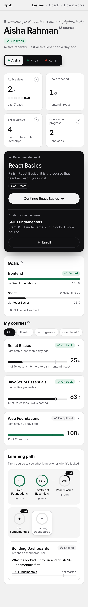
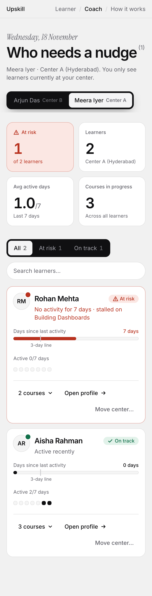
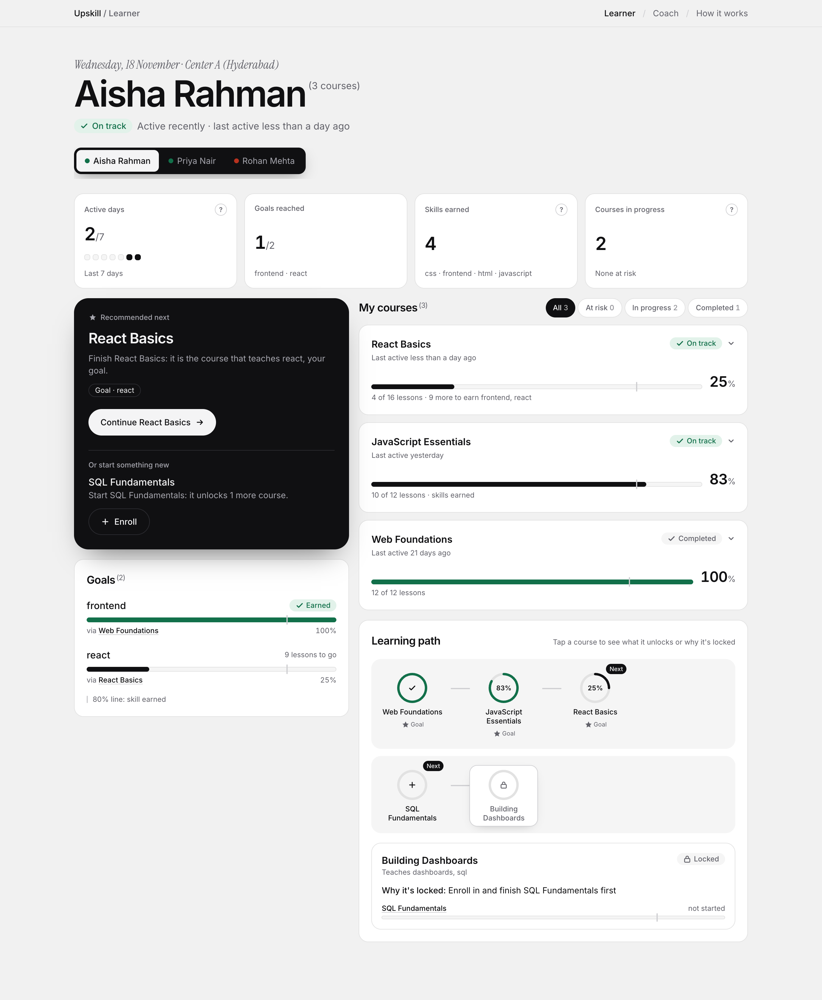
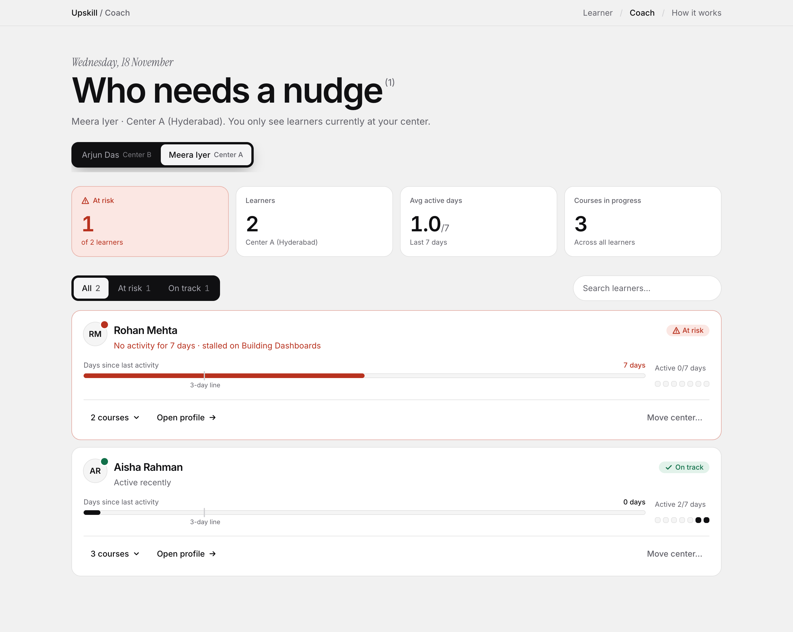
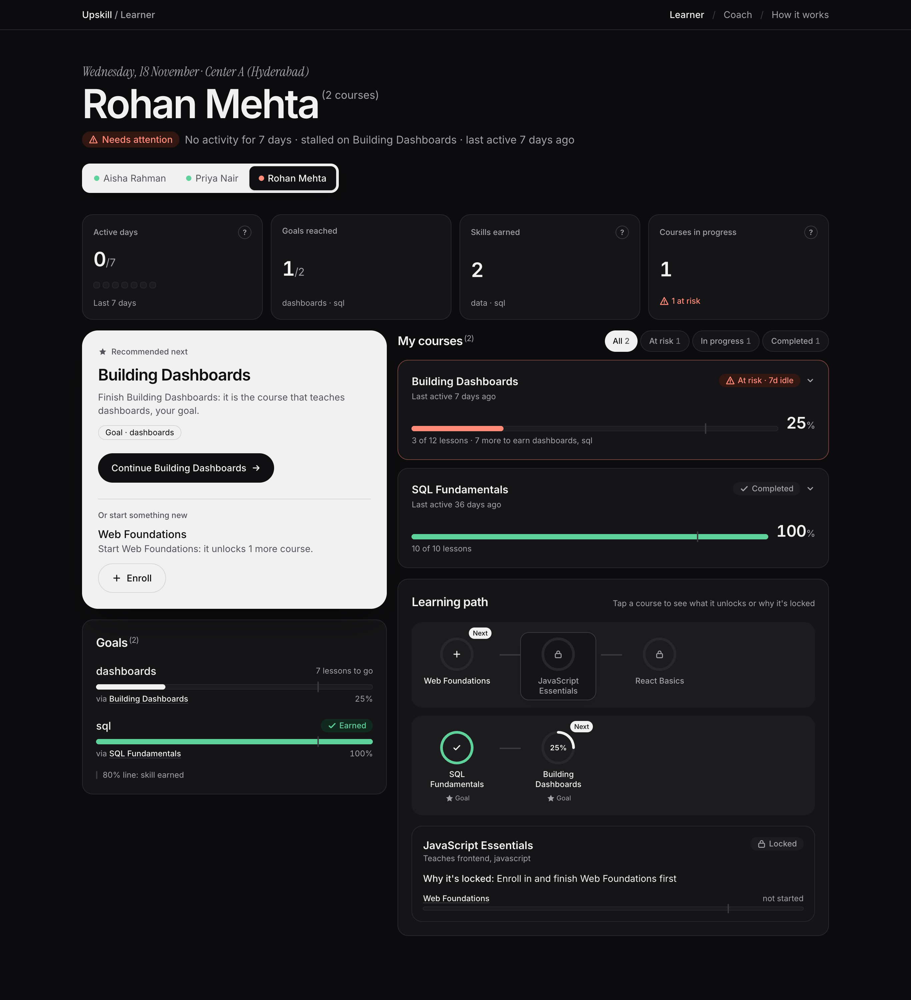

# Upskill

An internal learning dashboard for one job: **show coaches who is on track and who is at risk, and show each learner the one course to take next.** It is not a course catalog.

**Live demo:** _deploy link goes here_ · **Loom:** _link goes here_

| Learner view (375px) | Coach view (375px) |
|---|---|
|  |  |





Stack: Next.js 16 (App Router, Cache Components), Prisma 7 (`@prisma/adapter-pg`), Postgres, Tailwind 4, Vitest.

## What it does

The visual language is Swiss-minimal: a grey canvas, white cards with hairlines, near-black ink, Inter with an Instrument Serif accent, and a floating dark pill for switching. Colour is reserved for status, and always appears with an icon and text.

**Learner view (`/`)**
- **Header.** The date and center, the learner's name, and one status line: *On track* or *Needs attention*, with the reason ("No activity for 7 days · stalled on Building Dashboards"). A dark pill switches between learners, with a status dot on each; long lists fall back to a select.
- **Stat tiles.** Active days out of 7 (with a hoverable day strip), goals reached, skills earned, and courses in progress with the at-risk count. Each **?** opens a plain-words explanation.
- **Recommended next.** A dark focal card with one course, a one-line reason, and **Enroll** or **Continue**. When the top pick is "finish what you started", an enrollable alternative sits underneath.
- **Goals.** Each goal shows the course that gets the learner there, a progress bar with the **80% "skill earned" line** marked, and the lessons left.
- **My courses.** Filter chips (All / At risk / In progress / Completed) and cards that expand to show dates, lessons left, skills, and an at-risk nudge.
- **Learning path.** This is the interactive why-locked add-on. Prerequisite tracks are drawn as connected progress rings (finished, skills earned, in progress, open, locked), with goal and *Next* markers. Clicking a course shows exactly what is missing ("Finish SQL Fundamentals: 8 lessons left") with progress for each prerequisite, an **Enroll** button when it's open, or a jump to the course card.
- **Enroll is optimistic everywhere.** The course appears at once with *Enrolling…*. On success a toast confirms it and the recommendation, goals and path all recompute. On failure the card rolls back and an error toast shows the server's reason.

**Coach view (`/coach`)**
- **Scoping.** Pick a coach and see only learners at that coach's center.
- **KPI tiles.** At risk (highlighted), learners, average active days, and courses in progress.
- **Filtering.** At-risk / on-track filter pills and a search box.
- **Learner rows.** Each row shows the reason and a **days-inactive meter with the 3-day line marked**, plus a 7-day activity strip. Rows expand to show per-course progress, and *Open profile* jumps to the learner.
- **Move center.** Opens a confirm dialog that explains what happens (progress follows, history is kept, they leave your list). The row disappears optimistically and a toast confirms the move.

**Everywhere**
- **How it works.** A link in the header opens every rule in plain words, with the numbers pulled from the same constants the code uses.
- **States.** Skeletons while loading, an error card with *Try again*, empty states with guidance, and toasts announced through `aria-live`.
- **Accessibility.**
  - Fits a 375px screen with no sideways scrolling.
  - Every control is labelled, focus is always visible, and Esc closes dialogs.
  - Text contrast meets WCAG AA in light and dark mode.
  - Reduced-motion preferences are respected.

## Setup

Requires Node 20+ and Postgres 14+.

```bash
npm install                       # also runs `prisma generate`
cp .env.example .env              # set DATABASE_URL
npm run db:migrate                # apply migrations (prisma migrate dev)
npm run db:seed                   # load /seed/*.json (idempotent; re-run to reset the demo)
npm run dev                       # http://localhost:3000
```

Tests and checks:

```bash
npm test                          # 85 unit + seed-scenario tests (no DB needed)
createdb upskill_test             # once
npm run test:int                  # 17 integration tests against upskill_test (refuses any DB not named *_test)
npm run typecheck && npm run lint && npm run build
```

| Env var | Required | Purpose |
|---|---|---|
| `DATABASE_URL` | yes | Postgres connection string (local, Neon or Supabase). |
| `TEST_DATABASE_URL` | no | Integration-test database. Defaults to local `upskill_test`. |
| `NOW` | no | Freezes the app clock (ISO-8601) for screenshots and debugging. Defaults to real time. |

**Deploy (Vercel + Neon):**
1. Create a Neon database.
2. Run `DATABASE_URL=<direct url> npm run db:deploy && DATABASE_URL=<direct url> npm run db:seed`.
3. Import the repo in Vercel and set `DATABASE_URL` to the **pooled** URL. The build command (`prisma generate && next build`) is already in `package.json`.

**Reset the demo:** run `npm run db:seed`. It undoes enrolls and moves, and re-anchors the dates to today.

## Data model

JSON is only seed input. Postgres is the source of truth, and the schema is fully normalized.


| Table | Keys | Notes |
|---|---|---|
| `courses` | PK `id` | `total_lessons > 0`. Percent complete is **derived** (`completed_lessons / total_lessons`) and never stored. |
| `skills` | PK `id`, unique `name` | |
| `course_skills` | PK (`course_id`, `skill_id`) | Many-to-many. |
| `course_prerequisites` | PK (`course_id`, `prerequisite_course_id`) | CHECK rejects self-reference. Deleting a course that other courses require is restricted. |
| `centers` | PK `id`, unique `name` | |
| `coaches` | PK `id`, FK `center_id` | A coach belongs to exactly one center. |
| `learners` | PK `id` | Global identity, not tied to a center. |
| `learner_center_memberships` | PK `id`; **partial unique** (`learner_id`) `WHERE ended_at IS NULL` | At most one open membership per learner, enforced by the DB. History is kept. Partial index on (`center_id`) `WHERE ended_at IS NULL` serves coach queries. |
| `learner_goals` | PK (`learner_id`, `skill_id`) | |
| `enrollments` | PK `id`; unique (`learner_id`, `course_id`) | The unique key is what makes a double enroll return 409. |
| `activity_events` | PK `id`; index (`learner_id`, `occurred_at`) and (`learner_id`, `course_id`, `occurred_at`) | Append-only. Feeds active days and at-risk. |

### Multi-center: shared vs per-center

- **Shared (global):** `courses`, `skills`, `course_skills`, `course_prerequisites`. There is one catalog for every center.
- **Per-center:** `centers`, `coaches` (each coach has `center_id`).
- **Learner identity is global.** Center belonging lives only in `learner_center_memberships`.
- **Progress is global:** `enrollments` and `activity_events` have no `center_id`. **Decision:** course progress follows the learner when they move. Re-taking a course because of a move would be wrong for the learner, and this keeps a single row of truth per (learner, course).

**Coach scoping.** A coach sees a learner only if the learner's _open_ membership (`ended_at IS NULL`) is at the coach's center. Every coach query goes through one function that applies this filter, `visibleToCoachWhere(centerId)` in [`src/lib/queries.ts`](src/lib/queries.ts). The move endpoint uses the same rule: a coach can only move a learner they can currently see (403 otherwise). After a move, the old center's coach stops seeing the learner immediately, and the new center's coach sees their full history.

**Moving a learner.** One transaction sets `ended_at = now()` on the open row and inserts a new open row for the new center. The partial unique index makes a double move impossible: two open rows for one learner cannot exist.

**Seed additions (added by us):** the original seed has no centers or coaches. `seed/centers.json` adds Center A (Hyderabad, coach Meera Iyer) with Aisha and Rohan, and Center B (Bengaluru, coach Arjun Das) with Priya. This makes coach scoping visible.

## Rules and decisions on the seed data's traps

All rules are pure functions in [`src/lib/rules/`](src/lib/rules/), with thresholds in a single file, [`constants.ts`](src/lib/rules/constants.ts). They are tested in `*.test.ts` next to them, and [`src/lib/seed.test.ts`](src/lib/seed.test.ts) pins down what the seeded demo shows.

1. **Stale dates → shift on seed.** Every seed timestamp is from Aug-Oct 2026, so against real time everyone would be at-risk with 0 active days. The seed shifts **all** timestamps by the same **whole number of days** so the latest one lands within the 24 hours before seeding. Whole days keep times of day and every relative gap. The demo then shows a realistic mix: Aisha and Priya are on track, and Rohan is at-risk on Building Dashboards (7 days idle). The alternative, a fixed `NOW`, would make a live deploy look frozen in October. `NOW` still exists as an optional override for screenshots. Trade-off: the data ages, so re-run `npm run db:seed` to refresh it.
2. **"Complete" vs "earned" → Option B.** A course counts as _complete_ (for prerequisites) at **≥ 80%**, the same threshold as earning its skills. This is the single constant `COMPLETE_THRESHOLD_PCT`. It is consistent with the seed: Aisha's JavaScript Essentials is at 10/12 = 83%, which validly unlocks React Basics, so we don't have to flag seeded data as broken. The comparison uses integers (`completed*100 >= 80*total`) to avoid float edge cases. _Finished_ (100%) is a separate idea, used only for at-risk.
3. **Recommendation fallback.** In order:
   1. an eligible, unenrolled course teaching an unearned goal skill (most goals covered, then most unlocks, then id);
   2. the enrolled, unfinished course teaching the most unearned goal skills ("Finish React Basics: it is the course that teaches react, your goal.");
   3. an eligible, unenrolled course that unlocks the most other courses;
   4. none, with the specific reason (everything enrolled / nothing unlocked yet / no goals / goals all earned / no course teaches the goal).

   It always returns a one-line reason, and each branch has tests. With the seed, all three learners land on branch 2, because each already holds the course that teaches their goal. That would leave no Enroll button anywhere, so when the main pick isn't enrollable, `recommendAlternative` adds one secondary pick: branch 3, or else any open course ("it is open to you now"). It is also tested.
4. **No activity log → `activity_events`.** The seed creates one event per progress row (at `lastActiveAt`). Enrolling and progress updates append events. **Active days (last 7)** is the number of distinct `Asia/Kolkata` calendar dates with an event from today back 6 days (7 dates including today). Future events are ignored.
5. **At-risk.**
   - _Per course:_ not finished (< 100%) **and** no activity on that course for **more than** 3 × 24 h. Exactly 72 h still counts as on-track. A finished course is never at-risk; its badge reads "Completed". If a course has no events at all, the enrolment time counts as its last activity.
   - _Per learner (coach view):_ at-risk if any unfinished course is at-risk, **or** if there has been no activity at all for more than 3 days. A learner with no activity ever is also at-risk ("No activity recorded yet").
6. **Percent display** rounds down (199/200 shows 99%, never "100%" before every lesson is done).
7. **Seed validation.** `courses.json` has no lesson counts, so `total_lessons` comes from `progress.json`. The loader fails loudly if a course has two different totals, if a course has no total, if a prerequisite is unknown or self-referencing, if a progress row has no enrollment, or if completed > total.

## API

All responses are JSON. Errors look like `{ "error": "<code>", "reason": "<human sentence>" }`. Inputs are validated with zod, and every handler runs at request time.

| Method & path | Success | Errors |
|---|---|---|
| `GET /api/students` | `[{ id, name, centerName }]` for the picker | |
| `GET /api/students/:id` | goals, earnedSkills, activeDays7, activityStrip, courses (percent, status, daysInactive), recommendation and alternative (with reason), locked (why-locked) | 404 |
| `POST /api/enrollments` `{ studentId, courseId }` | **201** with the refreshed dashboard, so the recommendation is recomputed in one round trip | **400** ineligible, with the why-locked reason ("Enroll in and finish SQL Fundamentals first") or bad input · 404 · **409** already enrolled |
| `GET /api/coaches` | coaches with their center (for the switcher) | |
| `GET /api/coaches/:id/learners` | `{ coach, atRiskCount, learners[] }`, scoped to the coach's center and sorted | 404 |
| `GET /api/centers` | centers (move targets) | |
| `POST /api/learners/:id/move` `{ centerId, coachId? }` | `{ from, to, movedAt }` | 403 coach can't see this learner · 404 · 409 already at that center |

Eligibility is checked **on the server**, inside the enroll transaction. Races are settled by the database: two simultaneous enrolls hit `unique(learner_id, course_id)` and the loser gets a 409. Two simultaneous moves hit the partial unique index. Both cases have integration tests.

## Architecture

```
src/lib/rules/        pure business rules + unit tests (no I/O, `now` passed in), incl. the learning-path layout
src/lib/queries.ts    the only module that touches Prisma; composes rules into API shapes
src/lib/dto.ts        response types shared by routes and UI (type-only on the client)
src/app/api/**        thin route handlers: parse → query → JSON / errorResponse
src/components/**     client UI; fetch the API, optimistic updates via useOptimistic
test/*.int.test.ts    integration tests against a real Postgres
```

The pages are prerendered shells. The dashboards are client components behind `<Suspense>` that call the API, which is what makes optimistic enroll and move with rollback straightforward.

## Add-ons built

1. **Coach at-risk view.** This is the job the brief names first ("who is on track and who is at risk"). It shows the at-risk count up front, sorts by days inactive, gives a reason per learner, and links to the learner's detail. It also makes multi-center scoping visible.
2. **Why-locked hints.** "Finish JavaScript Essentials: 2 lessons left" plus a mini progress bar for each missing prerequisite. The same `lockedHint` text is the 400 reason the API returns, so the UI and the server always agree.
3. **Move learner between centers.** This proves the membership model end to end: history is kept, progress follows the learner, visibility flips between coaches, the coach-scope check gives 403, and the database stops double moves.

## Deliberately not built

- **Course catalog or browsing.** Out of scope per the brief. The product is triage, not discovery. The only course lists are the learner's own courses, one recommendation (plus one fallback), and locked courses with their reasons.
- **Authentication.** A Learner/Coach switcher and pickers stand in. The coach id is passed explicitly, so scoping is real at the API level, even though identity isn't verified.
- **Full multi-tenant admin UI.** The schema supports it; one move action proves the model.
- **Logging progress from the UI.** Lesson progress would come from the course player. Enroll and the seed are the only writers here.
- **Notifications or email,** and coach nudge notes.
- **Lesson content or a player.**

## How Claude was used

Claude Code (Claude Opus) was a pair programmer throughout:

- **Planning:** read the brief, proposed the work order, and identified the seed-data traps up front.
- **Schema:** wrote the Prisma schema and init migration, including the partial unique index (via Prisma's `partialIndexes` preview) and the hand-written CHECK constraints. Each constraint was verified against live Postgres.
- **Rules:** wrote the pure rule functions and 79 unit and scenario tests. I chose the rule decisions above (Option B, the whole-day seed shift, the strict "more than 3 days" check, the recommendation alternative) and reviewed each one.
- **Data layer and API:** wrote the query layer, the routes and 17 integration tests.
- **UI:** built the components, including a redesign modelled on a Swiss-minimal portfolio site I supplied as reference. It then drove headless Chrome through Playwright to check 375px layout, the optimistic enroll and its rollback (by forcing a 409), error and retry, keyboard focus, and the coach move. This caught two real bugs: a stale response could overwrite the next learner's view after switching, and a refresh after a move hid the confirmation.
- **Docs:** drafted this README.
