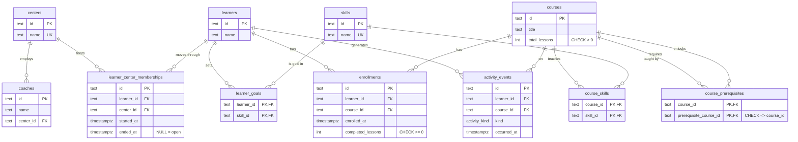

# Upskill

An internal learning dashboard for one job: **show coaches who is on track and who is at risk, and show each learner the one course to take next.** It is not a course catalog.

> Status: session 1 done (scaffold, schema, migration, seed, rule functions and tests). The API, UI and add-ons are next.
> Live deploy: _TBD_

Stack: Next.js 16 (App Router, Cache Components), Prisma 7 (`@prisma/adapter-pg`), Postgres, Tailwind 4, Vitest.

## Setup

```bash
npm install                       # also runs `prisma generate`
cp .env.example .env              # set DATABASE_URL
npm run db:migrate                # apply migrations (prisma migrate dev)
npm run db:seed                   # load /seed/*.json (re-run any time; it's idempotent)
npm run dev                       # http://localhost:3000
npm test                          # rule unit tests + seed scenario tests
npm run typecheck && npm run lint
```

| Env var        | Required | Purpose |
|----------------|----------|---------|
| `DATABASE_URL` | yes      | Postgres connection string (local, Neon or Supabase). |
| `NOW`          | no       | Freezes the app clock (ISO-8601) for screenshots and debugging. Defaults to real time. |

Production: `npm run db:deploy` (prisma migrate deploy), then `npm run db:seed`.

## Data model

JSON is only seed input. Postgres is the source of truth, and the schema is fully normalized.



| Table | Keys | Notes |
|---|---|---|
| `courses` | PK `id` | `total_lessons > 0`. Percent complete is **derived** (`completed_lessons / total_lessons`) and never stored. |
| `skills` | PK `id`, unique `name` | |
| `course_skills` | PK (`course_id`, `skill_id`) | Many-to-many. |
| `course_prerequisites` | PK (`course_id`, `prerequisite_course_id`) | CHECK rejects self-reference. Deleting a course that other courses require is restricted. |
| `centers` | PK `id`, unique `name` | |
| `coaches` | PK `id`, FK `center_id` | A coach belongs to exactly one center. |
| `learners` | PK `id` | Global identity, not tied to a center. |
| `learner_center_memberships` | PK `id`; **partial unique** (`learner_id`) `WHERE ended_at IS NULL` | At most one open membership per learner, enforced by the DB. History is kept. Partial index on (`center_id`) `WHERE ended_at IS NULL` serves coach queries. |
| `learner_goals` | PK (`learner_id`, `skill_id`) | |
| `enrollments` | PK `id`; unique (`learner_id`, `course_id`) | The unique key is what makes a double enroll return 409. |
| `activity_events` | PK `id`; index (`learner_id`, `occurred_at`) and (`learner_id`, `course_id`, `occurred_at`) | Append-only. Feeds active days and at-risk. |

### Multi-center: shared vs per-center

- **Shared (global):** `courses`, `skills`, `course_skills`, `course_prerequisites`. There is one catalog for every center.
- **Per-center:** `centers`, `coaches` (each coach has `center_id`).
- **Learner identity is global.** Center belonging lives only in `learner_center_memberships`.
- **Progress is global:** `enrollments` and `activity_events` have no `center_id`. **Decision:** course progress follows the learner when they move. Re-taking a course because of a move would be wrong for the learner, and this keeps a single row of truth per (learner, course).

**Coach scoping.** A coach sees a learner only if the learner's _open_ membership (`ended_at IS NULL`) is at the coach's center. Every coach query goes through one function that applies this filter (`learnersVisibleToCoach`, added with the API). After a move, the old center's coach stops seeing the learner immediately, and the new center's coach sees their full history.

**Moving a learner.** One transaction sets `ended_at = now()` on the open row and inserts a new open row for the new center. The partial unique index makes a double move impossible: two open rows for one learner cannot exist.

**Seed additions (added by us):** the original seed has no centers or coaches. `seed/centers.json` adds Center A (Hyderabad, coach Meera Iyer) with Aisha and Rohan, and Center B (Bengaluru, coach Arjun Das) with Priya. This makes coach scoping visible.

## Rules and decisions on the seed data's traps

All rules are pure functions in [`src/lib/rules/`](src/lib/rules/), with thresholds in a single file, [`constants.ts`](src/lib/rules/constants.ts). They are tested in `*.test.ts` next to them, and [`src/lib/seed.test.ts`](src/lib/seed.test.ts) pins down what the seeded demo shows.

1. **Stale dates → shift on seed.** Every seed timestamp is from Aug-Oct 2026, so against real time everyone would be at-risk with 0 active days. The seed shifts **all** timestamps by the same **whole number of days** so the latest one lands within the 24 hours before seeding. Whole days keep times of day and every relative gap. The demo then shows a realistic mix: Aisha and Priya are on track, and Rohan is at-risk on Building Dashboards (7 days idle). The alternative, a fixed `NOW`, would make a live deploy look frozen in October. `NOW` still exists as an optional override for screenshots. Trade-off: the data ages, so re-run `npm run db:seed` to refresh it.
2. **"Complete" vs "earned" → Option B.** A course counts as _complete_ (for prerequisites) at **≥ 80%**, the same threshold as earning its skills. This is the single constant `COMPLETE_THRESHOLD_PCT`. It is consistent with the seed: Aisha's JavaScript Essentials is at 10/12 = 83%, which validly unlocks React Basics, so we don't have to flag seeded data as broken. The comparison uses integers (`completed*100 >= 80*total`) to avoid float edge cases. _Finished_ (100%) is a separate idea, used only for at-risk.
3. **Recommendation fallback.** In order:
   1. an eligible, unenrolled course teaching an unearned goal skill (most goals covered, then most unlocks, then id);
   2. the enrolled, unfinished course teaching the most unearned goal skills ("Finish React Basics: it is the course that teaches react, your goal.");
   3. an eligible, unenrolled course that unlocks the most other courses;
   4. none, with the specific reason (everything enrolled / nothing unlocked yet / no goals / goals all earned / no course teaches the goal).

   It always returns a one-line reason, and each branch has tests. With the seed, all three learners land on branch 2, because each already holds the course that teaches their goal.
4. **No activity log → `activity_events`.** The seed creates one event per progress row (at `lastActiveAt`). Enrolling and progress updates append events. **Active days (last 7)** is the number of distinct `Asia/Kolkata` calendar dates with an event from today back 6 days (7 dates including today). Future events are ignored.
5. **At-risk.**
   - _Per course:_ not finished (< 100%) **and** no activity on that course for **more than** 3 × 24 h. Exactly 72 h still counts as on-track. A finished course is never at-risk; its badge reads "Completed". If a course has no events at all, the enrolment time counts as its last activity.
   - _Per learner (coach view):_ at-risk if any unfinished course is at-risk, **or** if there has been no activity at all for more than 3 days. A learner with no activity ever is also at-risk ("No activity recorded yet").
6. **Percent display** rounds down (199/200 shows 99%, never "100%" before every lesson is done).
7. **Seed validation.** `courses.json` has no lesson counts, so `total_lessons` comes from `progress.json`. The loader fails loudly if a course has two different totals, if a course has no total, if a prerequisite is unknown or self-referencing, if a progress row has no enrollment, or if completed > total.

## Add-ons

_Planned:_ coach at-risk view (scoped by center), why-locked hints (pure function `lockedHint` already tested), move learner between centers.

## Deliberately not built

- **Course catalog or browsing.** Out of scope per the brief. The product is triage, not discovery.
- **Authentication.** A role/user switcher stands in, which keeps the demo one click away.
- **Full multi-tenant admin UI.** The schema supports it; one move action proves the model.
- **Notifications and email.**
- **Lesson content or a player.**

## How Claude was used

Claude Code (Opus) was used to read the brief, scaffold the project, write the Prisma schema and migration (including the partial unique index and CHECK constraints), the seed loader and script, the rule functions and their tests. I reviewed each decision recorded above.
